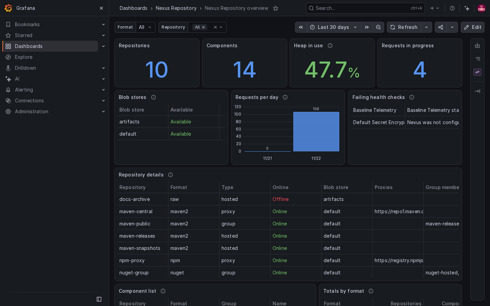

# Nexus Repository data source for Grafana

Shows what a Sonatype Nexus Repository 3 server holds and how it is doing, in
Grafana dashboards and alerts: repositories, blob store capacity, components
and assets, scheduled tasks, health checks, usage and the server's internal
metrics.

The plugin only reads. It talks to the Nexus REST API from the Grafana server,
so browsers never see the Nexus password.



## Requirements

- Grafana 13.2 or later.
- Nexus Repository 3. The plugin is developed and tested against **Community
  Edition 3.98**. Pro has the same REST API for everything the plugin reads,
  but is not tested. See [Known limitations](#known-limitations) for older
  versions.
- A Nexus user for Grafana (see below).

## Configuration

Add a data source of type **Nexus Repository** and fill in:

| Setting | What to enter |
| --- | --- |
| URL | The address you open Nexus at, including any path prefix: `https://nexus.example.com` or `https://tools.example.com/nexus` |
| User name, Password | A Nexus user for Grafana. A user token works too: its name code as the user name and its pass code as the password. Leave both empty only if Nexus allows anonymous access |
| TLS | A custom CA certificate, a client certificate, or (for testing only) no certificate verification |
| Query timeout | How long one panel query may take, 30 seconds by default |

**Save & test** connects, says which Nexus version answered and how many
repositories the user can see, and lists anything the user is not allowed to
read.

### What the user needs

Create a role in Nexus with the privileges for what you want to query, and
give it to a user that Grafana logs in as. Nothing here lets Grafana change
anything.

| Privilege | Needed for |
| --- | --- |
| `nx-repository-view-*-*-browse`, `nx-repository-view-*-*-read` | The repository list. Narrow these to the repositories Grafana should see |
| `nx-repository-admin-*-*-read` | Blob store, policies and group members in the repository list. Without it those columns are blank |
| `nx-search-read` | Components and assets |
| `nx-blobstores-read` | Blob stores |
| `nx-tasks-read` | Tasks |
| `nx-metrics-all` | Health checks, usage, totals by format and internal metrics |

A query that needs a privilege the user lacks fails with a message that names
the privilege.

### Grafana Cloud and a private Nexus

Grafana Cloud cannot reach a Nexus on a private network directly. Set up
[Private data source connect](https://grafana.com/docs/grafana-cloud/connect-externally-hosted/private-data-source-connect/)
and choose the connection under **Private network** in the data source
settings. In a Grafana you host yourself the section appears when the secure
socks proxy is enabled in Grafana's configuration.

### Provisioning

```yaml
apiVersion: 1
datasources:
  - name: Nexus
    type: smartquinoa1504-nexus-datasource
    access: proxy
    url: https://nexus.example.com
    jsonData:
      username: grafana
      timeoutSeconds: 30
    secureJsonData:
      password: $NEXUS_PASSWORD
```

## Queries

Choose what to ask for in the **Query** field.

| Query | Returns | Good for |
| --- | --- | --- |
| Repositories | One row per repository: format, type, online or offline, blob store, proxied URL, group members, policies | Tables; an alert on an offline repository |
| Totals by format | One row per format: repositories, components, assets, bytes downloaded and uploaded | Tables, bar and pie charts |
| Blob stores | One row per blob store: availability, blob count, size, free space, quota. Or one number per blob store: free space, size or blob count | Tables, gauges, alerts on free space |
| Components | Search results: repository, group, name, version, number of assets, size, last update, last download | Tables: what was published, what is never downloaded |
| Assets | Search results, one row per file: upload time, path, size, content type, last download, SHA-1, download URL | Tables, annotations |
| Tasks | One row per scheduled task: state, last result, last and next run | Tables; spotting a task that failed |
| Health checks | The system status checks with their result and message | Tables; a count of failing checks |
| Usage over time | Requests or components per day or per month | Time series |
| Monthly usage | Requests, components, peak storage and data served for each of the last twelve months | Tables, bar charts |
| Internal metrics | Current values from the Nexus process, such as heap use, thread count and request rates | Stats, gauges, alerts |

### Searching components and assets

- **Repositories**: leave empty for every repository, or choose some.
- **Format**: for example `maven2`, `npm`, `docker`.
- **Keyword** finds words anywhere in a component. **Group**, **Name** and
  **Version** match those fields exactly, with `*` standing for any text
  (`billing*`, `1.*`).
- **Sort by** and **Limit** decide which results you get when there are more
  than the limit (100 by default, at most 10,000). The editor says when
  results were left out.

Nexus searches one repository and one format at a time, so selecting several
makes one request each.

Nexus names the user who uploaded an asset only to administrators; for other
users the "Uploaded by" column is empty.

### Usage

Nexus keeps a figure per day for recent days and one per month for the last
year. Those are the points you get, whatever time range the dashboard has, so
choose a range that includes them (the last 30 days, or the last year for
monthly figures). A new server reports zeros until it has finished its first
day.

### Internal metrics

Choose metrics in the **Metrics** field; each becomes a number field holding
its current value. With no metric chosen, the query lists every metric and its
value, which is the way to find out what your Nexus reports.

Nexus does not keep a history of these. To chart them over time, record them
with a Grafana recording rule, or scrape Nexus' Prometheus endpoint.

Meters, timers and histograms are several numbers each; the plugin offers the
useful ones as `<name>.count`, `<name>.m1_rate`, `<name>.mean`, `<name>.p95`
and so on.

## Template variables

A variable of type **Query** can list **repositories** (optionally of one
format or type), **formats**, or **blob stores**. Use it by choosing the
variable in a query's Repositories or Format field. Variables set to several
values or to "All" work in both fields.

## Annotations

Add an annotation query and choose the **Assets** query, for example for one
hosted repository: each upload is marked at its upload time.

## Alerting

Queries run on the Grafana server, so they work in alert rules. Typical rules:

- **Internal metrics** with `jvm.memory.heap.usage`, reduced with "last",
  above 0.9.
- **Blob stores** with **Show** set to *Free space*, reduced with "last",
  below the space you want to keep. The rule gets one instance per blob
  store, labelled `blob_store`.

A rule needs one number per instance, which is what Internal metrics and the
Blob stores numbers give. The table queries are for panels.

## Security

- The password is stored encrypted by Grafana and sent only from the Grafana
  server to Nexus. Use an `https://` URL: the settings page warns when a
  password would be sent over plain HTTP.
- Use a dedicated Nexus user with only the read privileges listed above.
- Everyone who can query the data source sees what its Nexus user can see.
- Asset rows include download URLs. Opening one still requires the viewer's
  own access to Nexus.

## Known limitations

- Tested against Nexus Repository Community Edition 3.98 only. Usage over
  time and monthly usage rely on reporting that Nexus added with Community
  Edition (3.77); on older versions those two queries say that the data is not
  available.
- Nexus has no history for most of what it reports. Apart from usage, every
  query returns the current state.
- There is no cheap way to count components or measure size per repository in
  Community Edition; the plugin does not try to. Totals by format and blob
  store sizes are the closest figures.
- A search returns at most 10,000 results.
- Nexus Repository 2 is not supported.

## Feedback and contributing

Report problems and ideas in the
[issue tracker](https://github.com/Sam-H101/grafana-nexus-datasource/issues).
[CONTRIBUTING.md](https://github.com/Sam-H101/grafana-nexus-datasource/blob/master/CONTRIBUTING.md)
describes how to build and test the plugin.

This plugin is not made or endorsed by Sonatype. Nexus Repository is a
trademark of Sonatype, Inc.

## Licence

Apache-2.0.
